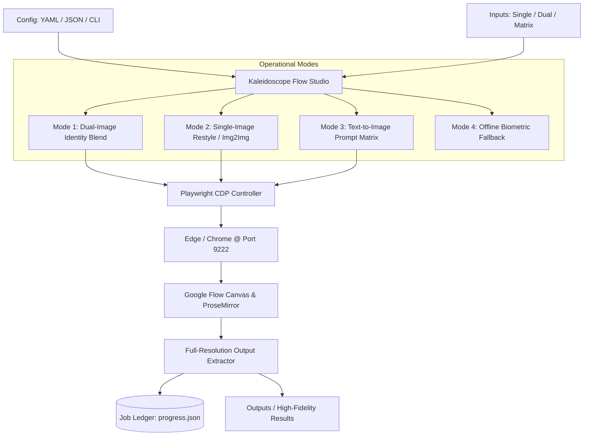

# Kaleidoscope Flow Studio 🎨

> **Universal Generative Batch Automation & Multi-Modal Workflow Studio for Google Flow**  
> *Automate, batch, and synthesize high-fidelity diffusion workflows with dynamic editable prompts, flexible multi-image slotting, and intelligent browser session management.*

[](https://www.python.org/)
[](https://playwright.dev/)
[](LICENSE)
[]()
[](https://github.com/psf/black)

---

## 🌟 Overview

**Kaleidoscope Flow Studio** is an open-source, configuration-driven batch synthesis engine built for **Google Flow** and modern generative canvas web interfaces. It bridges programmatic batch processing with cloud diffusion models via Playwright's Chrome DevTools Protocol (CDP), providing:

- ✍️ **Editable Dynamic Prompts**: Token variable interpolation (`{{subject}}`, `{{style}}`, `{{lighting}}`) and Cartesian combinatorial prompt matrices.
- 🖼️ **Multi-Mode Image Slotting**: Flexible dual-image identity blending, single-image restyling, and pure text-to-image matrix execution.
- 🚀 **1-Click CDP Attachment**: Seamless connection to existing Microsoft Edge or Google Chrome sessions on port `9222` with zero credential re-entry.
- 📋 **Native Clipboard Injection**: Pastes images as native clipboard blobs directly into canvas nodes, eliminating drag-and-drop glitches and duplicate cards.
- 🔄 **Fault-Tolerant Resumable Ledger**: Persistent task tracking (`jobs_ledger.json`) with automatic skips for finished items, error backoff, and retry queues.
- ⚡ **Offline Hybrid Module**: Optional local ONNX neural face-swap engine (InsightFace + CodeFormer) for instant local processing.



---

## 🎯 Operational Modes

| Mode | Input Slots | Use Case | Example |
| :--- | :---: | :--- | :--- |
| **`dual_image`** | Image 1 (Template) + Image 2 (Subject) | Swapping companion identity, yearbook selfies, dual-subject composition | Retain person on left; replace companion on right with Image 2 |
| **`single_image`** | Single Image | Image-to-image restyling, wardrobe transfer, art style transformation | Transform portrait into 1990s retro 35mm film aesthetic |
| **`text_only`** | None (Prompts only) | Batch prompt matrix evaluation, concept art generation, style testing | Generate $N \times M$ matrix across styles and subjects |
| **`offline_hybrid`** | Reference + Target (Local) | Offline instant face-swap without internet or browser | Local InsightFace ArcFace 512-D + ONNX swap |

---

## 📂 Repository Structure

```text
Kaleidoscope/
├── configs/
│   ├── default.yaml            # Global default configuration
│   └── presets/
│       ├── dual_image_blend.yaml    # Dual-image identity transfer preset
│       ├── dual_image_blend.json    # JSON equivalent
│       ├── single_image_restyle.yaml# Single-image restyle preset
│       ├── single_image_restyle.json# JSON equivalent
│       └── prompt_matrix.json       # Combinatorial prompt matrix preset
├── flow_studio/                # Core Python package
│   ├── __init__.py             # Exports & versioning
│   ├── browser.py              # Playwright CDP lifecycle & browser manager
│   ├── canvas.py               # ProseMirror typing, clipboard paste, dismissals
│   ├── downloader.py           # Output card detection & high-res image saver
│   ├── prompts.py              # Dynamic template engine & variable interpolation
│   ├── ledger.py               # Resumable state ledger & progress tracking
│   ├── config.py               # YAML & JSON configuration parser
│   └── cli.py                  # Command-line interface dispatcher
├── flow_runner.py              # Top-level CLI entry point
├── pipeline/                   # Optional offline neural face-swap engine
│   ├── detector.py             # Biometric anchor & landmark detection
│   ├── swapper.py              # InsightFace ONNX swapper
│   ├── restorer.py             # CodeFormer fidelity enhancer
│   ├── postprocess.py          # Reinhard color transfer & sensor noise
│   └── utils.py                # Image I/O & math utilities
├── scripts/
│   ├── launch_debug_edge.bat   # 1-Click Edge remote debugging launcher
│   ├── launch_debug_chrome.bat # 1-Click Chrome remote debugging launcher
│   ├── check_disk_usage.py     # System cache & storage analyzer
│   └── download_models.py      # Offline model weight downloader
├── inputs/                     # Source input directory (git-ignored)
├── outputs/                    # Output directory for results (git-ignored)
├── .github/workflows/ci.yml    # CI syntax and compilation validation
├── requirements.txt            # Dependency specification
├── LICENSE                     # MIT License
└── README.md                   # Project documentation
```

---

## 🚀 Quick Start

### 1. Installation

```bash
# Clone the repository
git clone https://github.com/Ahauyy/Kaleidoscope.git
cd Kaleidoscope

# Create and activate a virtual environment
python -m venv .venv
# Windows:
.venv\Scripts\activate
# Linux/macOS:
source .venv/bin/activate

# Install dependencies
pip install -r requirements.txt
playwright install chromium
```

### 2. Launch Browser with Remote Debugging (1-Click)

Run the provided batch script to launch your preferred browser on port `9222`:

- **For Microsoft Edge**: Double-click `scripts\launch_debug_edge.bat`
- **For Google Chrome**: Double-click `scripts\launch_debug_chrome.bat`

*Log in to your Google Flow account once. Your cookies and profile will remain safely saved in your local app data.*

---

## ⚡ Usage & Execution

### A. Run Using Configuration Presets

Inspect available presets:
```bash
python flow_runner.py list-presets
```

Run a preset:
```bash
# Dual-Image Identity Blend
python flow_runner.py run --config configs/presets/dual_image_blend.yaml

# Single-Image Restyle
python flow_runner.py run --config configs/presets/single_image_restyle.yaml

# Prompt Matrix (Text-to-Image)
python flow_runner.py run --config configs/presets/prompt_matrix.json
```

### B. Run Quick Ad-Hoc CLI Commands

**1. Dual-Image Swap:**
```bash
python flow_runner.py run \
  --mode dual_image \
  --template inputs/my_template.jpg \
  --inputs-dir inputs/faces/ \
  --prompt "Keep person on left unchanged. Replace person on right with Image 2. Natural candid lighting." \
  --wait 50
```

**2. Single-Image Style Transfer:**
```bash
python flow_runner.py run \
  --mode single_image \
  --inputs-dir inputs/portraits/ \
  --prompt "Convert into 1990s vintage film photograph, warm grain, golden hour light." \
  --wait 40
```

**3. Check Progress & Resume:**
```bash
# Check ledger summary
python flow_runner.py status --ledger outputs/dual_blend_results/jobs_ledger.json

# Resume or retry failed tasks
python flow_runner.py run --config configs/presets/dual_image_blend.yaml --retry-failed
```

---

## ⚙️ Configuration Reference (`YAML` / `JSON`)

```yaml
version: "2.0"
mode: "dual_image"   # dual_image | single_image | text_only

browser:
  cdp_port: 9222
  target_url: "https://flow.google.com"
  timeout_seconds: 55
  headless: false

inputs:
  template_image: "inputs/template.jpg"
  subjects_dir: "inputs/subjects"
  file_extensions: [".jpg", ".jpeg", ".png", ".webp"]

prompt:
  template: >
    In Image 1, keep the person on the left completely unchanged.
    Modify ONLY the companion on the right: replace them with the person from Image 2.
    Transfer facial features, hairstyle, and outfit.
    Style: {{lighting}} lighting, candid smartphone quality.
  variables:
    lighting: "indoor warm auditorium"

output:
  directory: "outputs/flow_results"
  prefix: "result_"
  format: "png"
  overwrite: false
```

---

## 🛡️ Privacy & Security

- **Zero Personal Data**: This repository contains strictly clean automation logic and generic example presets.
- **Strict Git Exclusion**: All runtime assets (`inputs/`, `outputs/`, `jobs/`, browser profiles, and logs) are automatically ignored by `.gitignore`.

---

## 📄 License

This project is licensed under the [MIT License](LICENSE) © 2026 Axell Satria Elarie.
