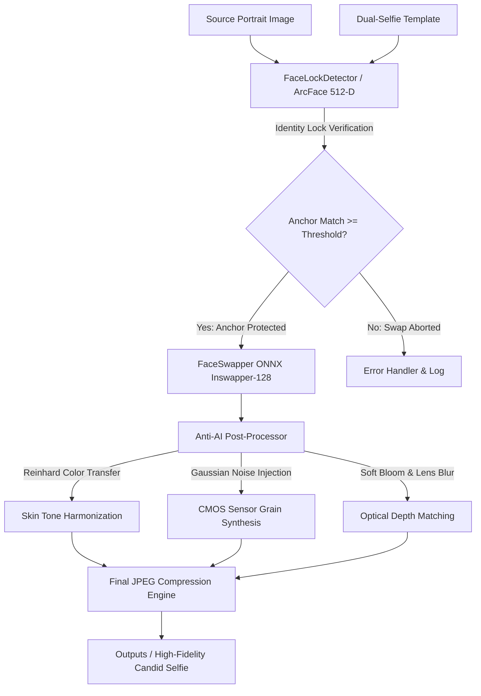

# Kaleidoscope 📸

> **Identity-Preserving Dual-Selfie Synthesis & Face-Swapping Pipeline**  
> *Engineered for high-fidelity candid portrait composition with authentic camera optics and zero "wax-look" generative artifacts.*

[](https://www.python.org/)
[](https://github.com/deepinsight/insightface)
[](LICENSE)
[]()
[](https://github.com/psf/black)

---

## 🌟 Overview

**Kaleidoscope** is an automated computer vision and deep learning pipeline designed to synthesize photorealistic dual-subject ("companion") selfies. Given a set of base dual-selfie templates and arbitrary source portraits, Kaleidoscope locks the biometric identity of the **anchor subject** while seamlessly transferring the identity of the **companion subject**—retaining natural camera characteristics, authentic lens softness, and indoor ambient lighting.



---

## ✨ Key Features

- 🔒 **Biometric Anchor Identity Lock**:
  - Uses InsightFace `buffalo_l` (ArcFace 512-dimensional normalized embeddings) to reliably identify and protect the primary selfie-taker across varying angles, poses, and lighting conditions.
  - Guarantees the anchor subject is **never** inadvertently swapped or distorted.

- 🎭 **Neural Face Swapping Engine**:
  - Powered by `inswapper_128.onnx` with 5-point facial landmark alignment.
  - Preserves head pose, facial orientation, and companion accessories (such as eyeglasses, head coverings/hijab, and neck straps).

- 📱 **Anti-AI Optical Harmonization**:
  - Eliminates the artificial "airbrushed / hyper-smoothed wax look" typical of standard generative diffusion outputs.
  - **Reinhard Color Transfer**: Harmonizes the transferred face's chromatic distribution ($L*a*b*$ space) with the scene's ambient lighting.
  - **Sensor Noise Synthesis**: Injects subtle pseudo-random CMOS sensor grain matching smartphone camera captures.
  - **Dynamic Lens Blur**: Softens edge seams using Poisson and Gaussian feathering.

- ⚡ **Batch CLI Runner & Diagnostics**:
  - Streamlined batch command-line interface with `tqdm` progress tracking, automatic fallback handling, and failure logging.
  - Built-in disk and runtime cache auditing tools (`scripts/check_disk_usage.py`).

---

## 📂 Repository Structure

```text
Kaleidoscope/
├── .github/workflows/          # GitHub Actions CI workflow
├── data/                       # Configuration schemas & sample specs
│   └── template_specs.example.json
├── inputs/                     # Target directory for source companion portraits
├── models/                     # Neural network weights (inswapper_128.onnx, buffalo_l)
├── outputs/                    # Output directory for generated selfies
├── pipeline/                   # Core neural vision modules
│   ├── __init__.py             # Package exports
│   ├── detector.py             # Biometric Anchor & Face Lock Detector
│   ├── swapper.py              # Inswapper ONNX inference engine
│   ├── restorer.py             # Facial detail fidelity enhancer
│   ├── postprocess.py          # Color transfer, grain injection & bloom
│   └── utils.py                # Image I/O, cosine math & logging
├── scripts/                    # Utility and setup scripts
│   ├── check_disk_usage.py     # System cache & storage analyzer
│   ├── create_reference_anchor.py # Crop reference anchor identity
│   └── download_models.py      # Automated neural weights downloader
├── templates/                  # Base dual-selfie templates & anchor reference
├── .gitignore                  # Production exclusion rules
├── LICENSE                     # MIT License
├── requirements.txt            # Dependency specification
└── run_batch.py                # Production batch CLI runner
```

---

## 🚀 Quick Start

### 1. Clone & Set Up Environment

```bash
# Clone the repository
git clone https://github.com/Ahauyy/Kaleidoscope.git
cd Kaleidoscope

# Create and activate a virtual environment
python -m venv .venv

# Windows:
.venv\Scripts\activate

# Linux / macOS:
source .venv/bin/activate

# Install required dependencies
pip install -r requirements.txt
```

### 2. Download Model Weights

Download the pre-trained neural network weights (`inswapper_128.onnx` and InsightFace `buffalo_l` pack) using the automated script:

```bash
python scripts/download_models.py
```

### 3. Prepare Reference & Templates

1. Place your base dual-selfie template photos in `templates/` (e.g., `base_male.jpeg`, `base_female.jpeg`).
2. Generate or place your reference anchor photo:
   ```bash
   python scripts/create_reference_anchor.py --source templates/my_photo.jpg --output templates/ref_anchor.jpg --side left
   ```
3. Place source portrait photos into `inputs/`.

### 4. Run Batch Synthesis

```bash
python run_batch.py --device cuda --quality 82
```

#### CLI Options:
| Flag | Default | Description |
| :--- | :---: | :--- |
| `--inputs` | `inputs` | Directory containing source portraits |
| `--outputs` | `outputs` | Directory to save generated photos |
| `--templates` | `templates` | Directory containing base templates |
| `--ref-anchor` | `templates/ref_anchor.jpg` | Biometric anchor portrait |
| `--device` | `cuda` | Compute device (`cuda` or `cpu`) |
| `--quality` | `82` | JPEG quality factor (78–85 recommended) |

---

## 🔬 Mathematical & Architectural Details

### Biometric Identity Cosine Metric
The face detector extracts normalized feature vectors $v \in \mathbb{R}^{512}$ via ArcFace:

$$\text{Sim}(v_{\text{anchor}}, v_{\text{template}}) = \frac{v_{\text{anchor}} \cdot v_{\text{template}}}{\|v_{\text{anchor}}\| \|v_{\text{template}}\|}$$

If $\text{Sim} \ge \tau$ (default $\tau = 0.45$), the face is classified as the immutable anchor and shielded from modification.

### Reinhard Color Harmonization
Skin tones are balanced across the $L\alpha\beta$ color space:

$$L^*_{\text{new}} = \left(L^*_{\text{source}} - \mu^L_{\text{source}}\right) \left(\frac{\sigma^L_{\text{target}}}{\sigma^L_{\text{source}}}\right) + \mu^L_{\text{target}}$$

This preserves authentic facial features while matching the ambient color temperature of the template scene.

---

## 🛡️ Privacy & Compliance

This repository contains **strictly clean, open-source code and public model references**.
- **No personal user data, private portraits, or third-party datasets** are committed or tracked.
- All runtime inputs (`inputs/`), templates (`templates/`), and results (`outputs/`) are excluded via `.gitignore`.

---

## 📄 License

This project is licensed under the [MIT License](LICENSE) © 2026 Axell Satria Elarie.
